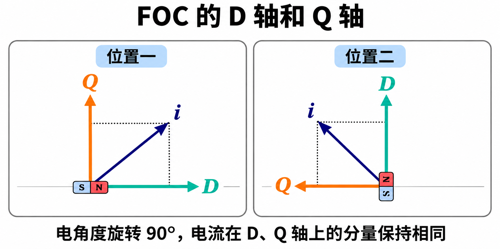

力反馈旋钮有三根电机线，可 SimpleFOC 的图上却画着两条电流曲线，叫作 `Cd` 和 `Cq`。要理解它们，先想一个具体的问题：旋钮已经转过一段角度，我想让它继续以同样的力拧我的手，线圈里的电流该怎么变？

## 从一块能自由转动的磁铁说起

把一根条形磁铁支在中心，让它能自由转动。用线圈在它周围产生磁场。如果磁铁已经顺着这个磁场摆好，磁场几乎没有让它继续转动的力矩。如果让同样强的磁场横过来，磁铁就会转过去，试图与它对齐。可见，想控制转矩，除了知道磁场有多强，还要知道它相对磁铁指向哪里。

在永磁电机里，磁铁跟着转子转，三相线圈固定在定子上。对这种三线电机，三个瞬时相电流之和为零。知道其中两个，就能推出第三个。三相电流共同产生的磁场，可以用转动平面内的一根箭头描述。FOC 再给这根箭头选一套便于控制转矩的坐标。

## 把一把直角尺固定在转子磁场上

看左图。绿色 **D 轴**沿着转子永磁体的磁场，橙色 **Q 轴**与它相差 90° 电角度。蓝色箭头是定子电流的合成矢量。沿两条虚线看它的投影：向右的分量叫 **Id**，会增强或削弱沿转子磁场方向的磁通；向上的分量叫 **Iq**，是这只旋钮产生转矩时主要控制的电流。

再看右图。转子磁场转了 90° 电角度，D 轴现在朝上，Q 轴朝左。假设还要维持刚才的两个电流分量，控制器就得改变三相电流，让蓝箭头也同步转过去。从桌面看，蓝箭头换了方向；从转子上看，它在绿色和橙色两把刻度尺上的读数都没有变。

这就是换坐标的好处。要让旋钮持续给手一个方向、大小都稳定的力矩，三相绕组的电流得随转角不断变化。在 D/Q 坐标里，同一件事却可以写成两个固定目标：让 **Id 接近零**，让 **Iq 跟随指定值**。图里为了展示两种投影，特意画了一根斜箭头；当 Id 为零时，蓝箭头就贴在橙色轴上。改变 Iq 的正负，力矩就会反向。

## 为什么旋钮还要校准角度

编码器测到的是轴的机械角度，控制器需要的是转子磁场的电角度。我们这只旋钮测得 **7 个极对**：轴转一整圈，电角度走过七个周期。图里转过的 90° 电角度，在这只旋钮上只对应约 **12.9° 机械角度**。

知道极对数还不够，还要知道编码器读数增加的方向，以及哪个编码器位置对应电角度零点。否则控制器心里的直角尺就放歪了，本来要沿 Q 轴输出的电流会有一部分投到 D 轴上。这也是有了磁编码器之后，仍需要做方向和电角度零点校准的原因。

## 在 SimpleFOC 里看哪条线

在这只旋钮的 FOC 电流力矩模式下，如果目标是 **+0.02 A**，理想的稳态读数是 **Cq 接近 +20 mA，Cd 接近 0 mA**。这个例子是读图的方法。目标使用安培，图上两条电流曲线使用毫安，比较前要先统一单位。

想改变手上感受到的力，调的是 **Iq 目标**。想让实际电流更快跟上目标、减少振荡或稳态误差，才需要观察电流曲线并调电流环的 PI 参数。在电机输出关闭时看到的零点附近波动，只能用来观察采样噪声；评估闭环跟随效果需要在完成校准并稳定使能后进行。

关于两条电流环怎样分别计算控制电压，可参阅 [SimpleFOC 官方电流力矩控制说明](https://docs.simplefoc.com/foc_current_torque_mode)。
